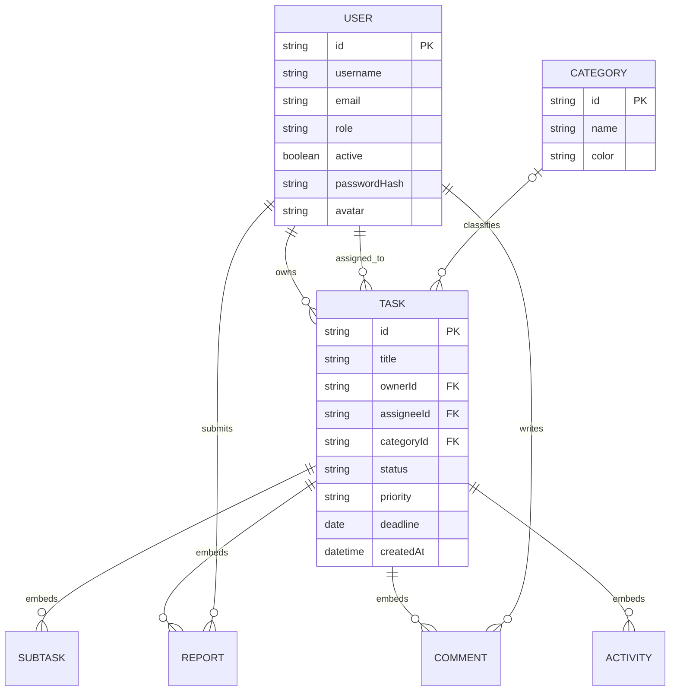

# TaskMaster Data Design

## 1. Current storage

The app currently persists JSON files, not a SQL database:

- `data/users.json`: account array, read and updated by `scripts/auth-server.cjs`.
- `data/database.json`: local `tasks` and `categories` arrays, exposed by JSON Server and excluded from Git.
- `data/database.example.json`: empty safe template copied to `database.json` on first startup when no local database exists.
- `data/uploads/`: uploaded file bytes; `data/backups/` receives a copy.
- Browser `localStorage`: task/category read cache and UI preferences.

## 2. Entity relationship overview

The diagram presents logical relationships. In the current JSON representation, subtasks, reports, comments, and activity are nested arrays inside each task rather than separate collections. IDs are application generated strings. The JSON files do not enforce foreign keys or uniqueness constraints.

## 3. Current document fields

### User (`data/users.json`)

| Field | Meaning |
|---|---|
| `id` | Stable user identifier referenced by tasks. |
| `name`, `username`, `email`, `phone` | Profile and contact information (some optional). |
| `role` | `admin`, `manager`, or `user`. |
| `active` | Whether login is allowed. |
| `passwordHash` | Scrypt encoded password; never expose to the browser. |
| `avatar` | Optional uploaded file URL. |
| `emailVerified`, token hashes/expiry fields | Verification and recovery state as used by auth routes. |

### Category (`data/database.json`)

`id`, `name`, and `color` identify a task category.

### Task (`data/database.json`)

| Field | Meaning |
|---|---|
| `id`, `title`, `description` | Task identity and content. |
| `ownerId`, `assigneeId` | Creator/owner and assigned user IDs. |
| `categoryId`, `categoryName` | Category reference and optional denormalized display name. |
| `status` | Workflow state; see [workflow.md](workflow.md). |
| `priority`, `deadline`, `createdAt` | Priority and scheduling metadata. |
| `subtasks[]` | Checklist item ID, text, done flag, and optional comments. |
| `reports[]` | Progress/completion/cancellation report, attachments, author, and optional review. |
| `comments[]` | Task discussion entries. |
| `activity[]` | Task history items. |
| `recurrence` | Optional recurring-task configuration. |
| `deadlineChangeRequest`, `cancellationRequest` | Optional request and reviewer state. |

Actual optional fields vary by workflow and existing records. Treat fields as optional unless a form or operation requires them.

## 4. Integrity and production target

The current files provide no database-level referential integrity, transaction isolation, or concurrent write protection. A production relational design should normalize users, categories, tasks, subtasks, reports, report attachments, comments, activity events, and review requests. Add foreign keys for owner, assignee, category and author references; indexes on task status, assignee, owner, category, and deadline; and transactionally update task status with its review record. Store file bytes in object storage and retain metadata/owner references in the database.
