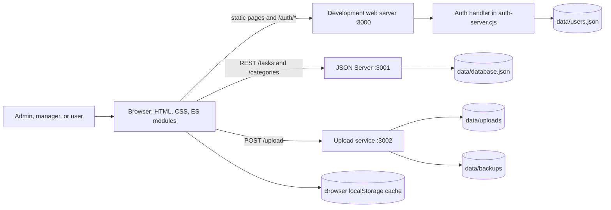

# TaskMaster Software Architecture Design

## 1. Purpose and scope

TaskMaster is a role based web application for assigning, tracking, discussing, and reviewing work. This document describes the architecture implemented in this repository: a browser based multi page application, local Node.js services, JSON file storage, and a file upload service. It also records the main limits of the current prototype.

## 2. System context

`npm run dev` starts the development web server, JSON Server, and upload service. The web server serves the static app and delegates `/auth/*` routes to the auth handler. `public/js/api-config.js` supplies API base URLs. `public/js/storage.js` reads and writes tasks and categories through JSON Server, with a localStorage fallback for reading when the API is unavailable.

## 3. Application components

| Layer | Implementation | Responsibility |
|---|---|---|
| Pages and presentation | Root `*.html`, `css/*.css` | Task lists, Kanban, task details and forms, calendar, categories, users, account and authentication screens. |
| Browser behavior | `public/js/*.js` ES modules | Page initialization, form validation, rendering, filtering, account interactions, and task workflows. |
| Authentication | `public/js/auth.js`, `scripts/auth-server.cjs` | Login/logout, cookie session, account administration, password recovery, email verification, and role checks. |
| Task and category data | `public/js/storage.js`, JSON Server | Client-side task/category operations and persistence to `data/database.json`. |
| Uploads | `public/js/uploads.js`, `scripts/upload-server.cjs` | Avatar and attachment uploads; stores files under `data/uploads` and copies them to `data/backups`. |
| Data | `data/users.json`, `data/database.json` | User accounts are separate from task/category records. Task nested arrays hold checklist, reports, comments, and activity. |

## 4. Roles and core workflows

- **Admin:** administers users, reviews completion reports, and resolves cancellation or deadline change requests.
- **Manager:** creates and edits work, assigns tasks, manages categories, and tracks related work.
- **User:** views assigned work, accepts it, updates checklist and progress, comments, and submits work for review.

Task statuses include `request-pending`, `pending`, `in-progress`, `awaiting-review`, `needs-revision`, `completed`, and `cancelled`. The status transition rules are implemented mainly in `public/js/storage.js` and permission checks in `public/js/auth.js`; see [workflow.md](workflow.md).

## 5. Data and persistence

The app uses JSON documents rather than a relational database. `data/users.json` stores account records and password hashes. `data/database.json` stores `tasks` and `categories`; each task embeds subtasks, reports, comments, activity, and optional deadline/cancellation requests. Upload metadata is stored in task/user records as URLs, while file bytes are on disk.

There is no transaction spanning a browser cache, JSON Server, and the file upload service. The browser cache is a convenience fallback, not a durable offline synchronization queue. See [Database.md](Database.md) for fields and relationships.

## 6. Security and operational boundaries

- Passwords are hashed with Node.js `scrypt`; auth responses omit password and token secrets.
- Auth sessions are held in process memory and use an HTTP-only cookie. Restarting the auth service invalidates sessions.
- Several task authorization checks run in browser code because JSON Server exposes task/category REST routes directly. This is suitable only for a local/demo setup; a public deployment needs a trusted API that enforces authorization on the server.
- The upload service validates declared MIME type and size but currently allows cross-origin requests and has no session authorization. Do not expose it publicly without server-side authentication, content inspection, and quotas.
- JSON files are simple prototype persistence. Concurrent writes, multi-instance deployment, auditability, and recovery need a transactional database and operational backup policy.

## 7. Suggested production evolution

Keep the multi-page client if it meets product needs, but put task, category, user, and upload operations behind an authenticated application API. Enforce role and ownership rules there, move structured data to a transactional database, store uploads in managed object storage, and persist sessions and audit events. These are target-state recommendations, not existing implementation claims.
