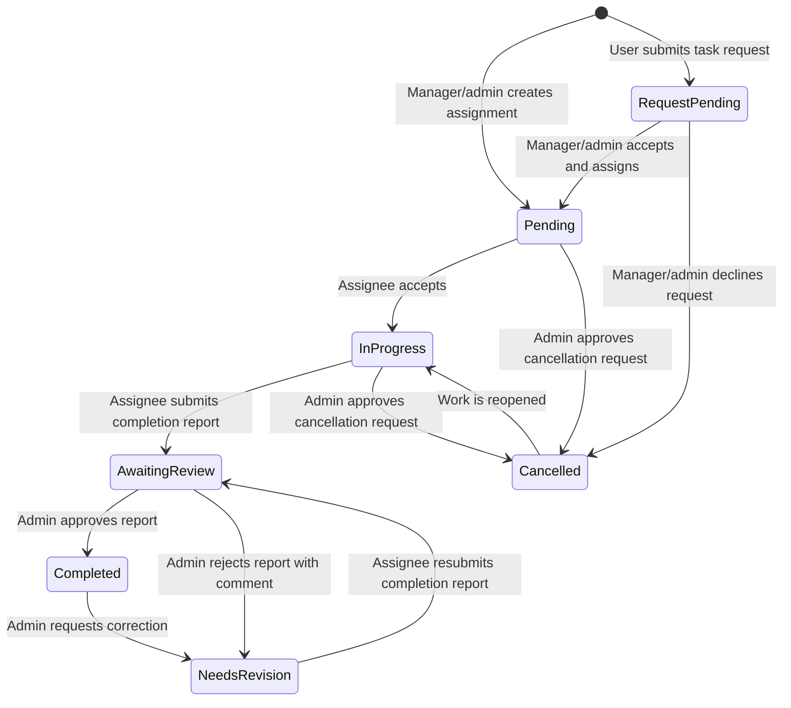
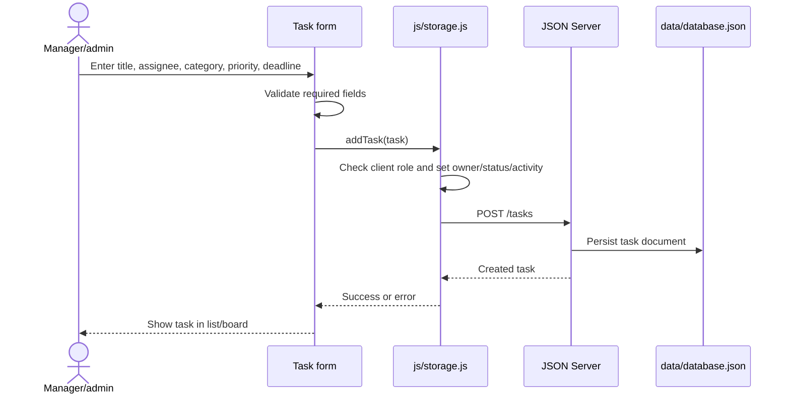
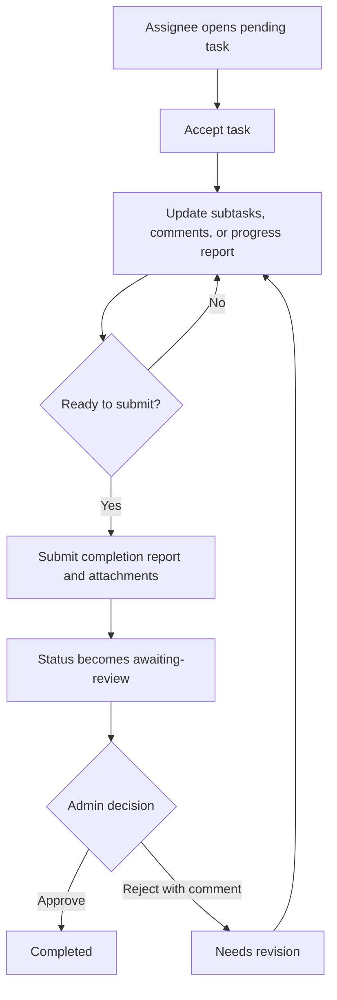
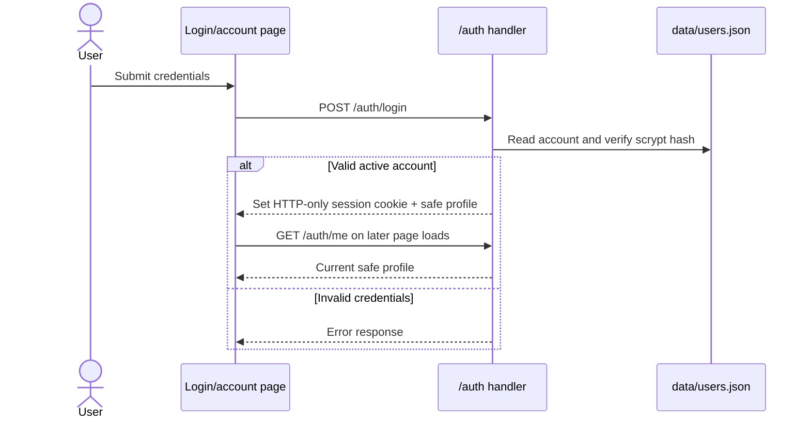

# TaskMaster Workflows

This document describes the workflows visible in the current UI and implemented by the client storage/auth modules. The browser flowcharts show the service boundaries; current task permissions are substantially client-side.

## 1. Task lifecycle

Overdue is a derived view based on deadline and non-terminal status, not a stored status. Cancellation and deadline changes have request/review steps and can block completion review while pending. Recurring tasks may create a new pending task after approval of the current occurrence.

## 2. Create a task

## 3. Work and request completion

## 4. Account access

Password recovery and email verification are separate token-based routes. Email delivery uses configured SMTP in production; development can print preview links to the server console.

## 5. Failure paths and current boundaries

- Invalid form input remains on the form and displays validation feedback.
- Failed API writes are reported to the caller; some task operations optimistically update local state and attempt rollback. Cached data does not automatically synchronize later.
- If task/category reads fail, `Storage.init()` attempts the browser's localStorage cache.
- Upload failures return an error; successful uploads create both a primary file and a backup copy.
- Task authorization in the UI is not a security boundary while JSON Server is directly reachable. Enforce every transition in a trusted server API before public deployment.
